# PlayMate

Book sports venues and find players near you. PlayMate is a frontend-only React app built as a hiring assessment. It has five player screens, a venue-owner dashboard, and realistic dummy data. Everything persists in `localStorage`.

**Live demo:**https://playmate-candidate.vercel.app/

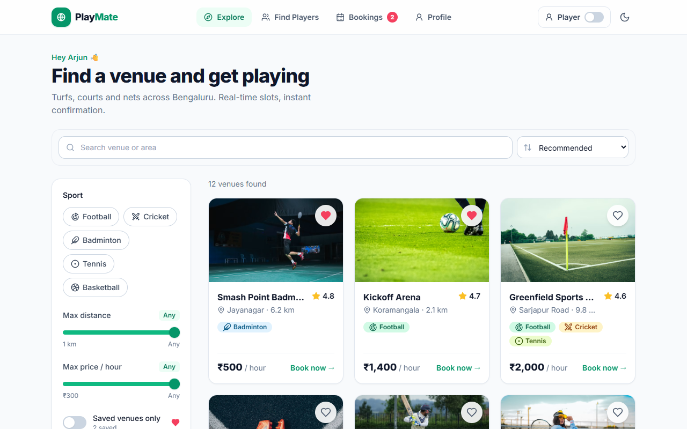

---

## Contents

- [Run it locally](#run-it-locally)
- [What's inside](#whats-inside)
- [Folder structure and why](#folder-structure-and-why)
- [Components built](#components-built)
- [Where state lives and why](#where-state-lives-and-why)
- [Features I added, and why](#features-i-added-and-why)
- [Quality checklist](#quality-checklist)
- [What I'd improve with more time](#what-id-improve-with-more-time)
- [Screenshots](#screenshots)

## Run it locally

Requires Node 18+.

```bash
npm install
npm run dev        # http://localhost:5173
npm run build      # type-check + production build (no errors, no warnings)
npm run preview    # serve the production build
```

**Deploying:** the project is static. `vercel.json` (Vercel) and `public/_redirects` (Netlify) rewrite every route to `index.html`, so deep links like `/venue/kickoff-arena` work on refresh.

**Resetting data:** click **Reset demo data** in the footer to restore the seed state.

## What's inside

| Route | Screen |
| --- | --- |
| `/` | **Explore.** Search by name or area. Filters for sport (multi-select), max distance, max price and saved-only all combine in real time. Sort by recommended, distance, price or rating. Skeletons on first load, and an empty state with **Reset filters**. |
| `/venue/:id` | **Venue details and booking.** Photo carousel, description, amenities, a location link to Maps, and rating. Pick a date (next 7 days), then one or more slots, with a live price summary. Then a confirmation modal, a success screen, and sharing via copy-link or `.ics`. |
| `/players` | **Find Players.** Open games with sport, venue, time, skill level, spots left and host. **Join** turns into **Request sent** (persisted). The **Post a game** form is validated, and new games appear at the top of the list. Filter by sport, skill and beginner-friendly. |
| `/bookings` | **My Bookings.** Upcoming and Past tabs (the tab is kept in the URL). Cancelling asks for confirmation, frees the slot, and offers **Undo**. Past bookings have **Book again**. Each tab has its own empty state. |
| `/profile` | **Profile.** Avatar, name, city, and sports played. Four stat tiles, a games-per-sport chart and a games-per-month chart. Name, city, sports and avatar colour are editable. |
| `/owner` | **Owner dashboard.** Today's slots booked, revenue and occupancy. Per-venue occupancy, a slot manager to block and unblock slots, the day's bookings, and **Add venue**. |
| `*` | 404 page. |

## Folder structure and why

```
src/
├── components/
│   ├── ui/          Design-system primitives: no business logic, reusable anywhere
│   ├── layout/      App shell: top nav, bottom tab nav, toggles, footer
│   ├── venue/       VenueCard, filters, gallery, amenities, favourite button
│   ├── booking/     DateStrip, SlotGrid, PriceSummary, booking modals, BookingCard
│   ├── game/        GameCard, GameFilterBar, PostGameModal
│   ├── owner/       AddVenueModal, DayBookingsList, VenuePerformanceList
│   └── profile/     EditProfileModal
├── pages/           One file per route; composes components, lazy-loaded
├── store/           Zustand store (persisted) — the single source of truth
├── hooks/           Derived data & behaviour (filters, slot status, stats…)
├── services/        api.ts — the only place that reads seed data
├── data/            Seed venues, games, user, bookings, sport metadata
├── utils/           Pure functions: dates, slots, formatting, .ics, owner reports
└── types/           Shared domain types
```

- **Grouped by domain, not by file type.** Everything about booking lives in `components/booking`, so a reviewer, or a teammate working on a feature, finds it in one place.
- **Pages stay thin.** They wire hooks to components. All business rules live in `utils/` and the store, and nothing in them is tied to React, so they are easy to unit-test.
- **One slot-availability rule.** `utils/slots.ts#getSlotStatus` is used by the player booking grid, the store's validation, and the owner dashboard. It is impossible for them to disagree about whether a slot is free.
- **A swappable service layer.** Components never import from `data/`. `services/api.ts` exposes `fetchVenues()`, `getSeedGames()` and similar functions. Replacing their bodies with `fetch()` calls is the only change needed for a real API.

## Components built

**UI primitives (`components/ui`)**
- `Button`, `ButtonLink`: variants and sizes, with a loading state.
- `Modal`: focus trap, Escape to close, restores focus on close, scroll lock. Renders as a bottom sheet on mobile.
- `ConfirmDialog`.
- `Tabs`: WAI-ARIA tabs with arrow-key, Home and End navigation.
- `FormField`: wires label, hint, error and `aria-describedby` automatically.
- `ToggleChip`, `RangeSlider`, `Switch`.
- `SafeImage`: fades in, and falls back if the CDN fails.
- `Skeleton`, `EmptyState`, `Badge`, `SportBadge`, `SportIcon`, `Rating`, `Avatar`, `StatCard`, `PageHeader`.
- `HorizontalBarChart`, `ColumnChart`: CSS charts with a screen-reader data table and hover tooltips.

**Layout:** `AppLayout`, `TopNav`, `BottomNav`, `ModeToggle`, `ThemeToggle`, `NavBadge`, `Logo`, `Footer`, `PageLoader`.

**Venue:** `VenueCard`, `VenueCardSkeleton`, `VenueFilterPanel`, `VenueGallery`, `AmenityList`, `FavoriteButton`.

**Booking:** `DateStrip` (radio group with arrow keys), `SlotGrid` (player and owner modes, with a legend), `PriceSummary`, `ConfirmBookingModal`, `BookingSuccessModal`, `ShareBookingActions`, `BookingCard`.

**Game:** `GameCard`, `GameFilterBar`, `PostGameModal`.

**Owner:** `AddVenueModal`, `DayBookingsList`, `VenuePerformanceList`.

**Profile:** `EditProfileModal`.

**Hooks:** `useVenues`, `useVenuesLoading`, `useVenueFilters`, `useSlotStatuses`, `useNow`, `useBookingGroups`, `usePlayerStats`, `useDebouncedValue`, `useDocumentTitle`, `useThemeEffect`.

## Where state lives and why

| State | Where | Why |
| --- | --- | --- |
| Bookings, posted games, join requests, favourites, profile, blocked slots, owner-added venues, theme, mode | **Zustand store** (`store/useAppStore.ts`), persisted to `localStorage` with `persist` middleware | Shared across many screens. A booking must show up on the venue page, My Bookings, the nav badge, the owner dashboard and profile stats at once. A single store with selectors avoids prop-drilling and re-renders only what changed. Zustand gives Context + reducer ergonomics with less boilerplate. |
| Derived data: slot status, upcoming/past split, stats, owner reports | **Hooks and pure utils**, computed with `useMemo` | It is never stored, so it can't go stale. Cancelling a booking frees its slot everywhere automatically. |
| Search text, filters, sort, selected date/slots, modal open state, form fields | **Local `useState`** in the page or component | It is UI state that nobody else needs. Bookings tab state lives in the URL (`?tab=past`) so it survives refresh and is linkable. |
| Seed data (venues, demo user, initial games and bookings) | **`data/`**, read only through `services/api.ts` | Static. It stands in for a backend. |
| "Other players'" bookings | **Deterministic hash** of `venue + date + hour` (`utils/slots.ts`) | Gives realistic, stable availability (~25–40% booked, busier in the evenings) without storing thousands of rows. |

**Double-booking protection** works in three layers:
1. The UI disables any slot that isn't `available`.
2. `createBooking` re-validates every requested hour against the current state before saving. It returns an error result rather than trusting the UI.
3. A `storage` event listener rehydrates the store when another tab writes. A slot booked in tab A is shown as taken in tab B immediately, and if it was selected in tab B it gets dropped with a warning toast.

## Features I added, and why

| Feature | Why it matters to a **player** | Why it matters to a **venue owner** |
| --- | --- | --- |
| **Venue Owner mode** (`/owner`, toggle in the nav) | — | The brief mentions venue owners, but the five required screens are all player-side. Owners need a quick read on today's numbers (slots booked, revenue, occupancy) and control over their inventory: blocking slots for maintenance or a private event, and listing a new venue. A block is reflected on the player side immediately. |
| **Split the cost** | The biggest friction in pickup games is "who pays?". Linking a booking to a posted game shows **₹ per player** on the card, so people know the cost before they join. The booking success screen offers "Post a game & split the cost" to make that path one tap. | Full games mean booked courts. Easier cost-sharing means more bookings. |
| **Favourites + Saved filter** | Most players rotate between 2–3 regular venues. Hearting them makes rebooking fast. | Repeat customers. |
| **Skill level + Beginner-friendly tags** | Turning up to a game far above or below your level is a bad experience. Beginner-friendly tags help new players feel welcome. | A wider player base fills off-peak slots. |
| **Dark mode** (persisted, no flash on load) | Many bookings happen late in the evening. | — |
| **Share booking** (copy link, `.ics` with a 1-hour reminder) | Coordinating friends happens in WhatsApp and calendars, not in the app. | Fewer no-shows. |
| **Book again**, **Undo cancel**, **upcoming-bookings badge**, live "N free" counts per date, skeletons, animated transitions | Fewer taps for the most common repeat actions, and confidence that the app did what you asked. | — |
| **Reset demo data** | Lets a reviewer get back to a clean state after trying everything. | — |

## Quality checklist

I verified this in a real browser (Edge, driven by Playwright) against the production build. The checks ran at **1280px** and **375px**: 50 automated checks passed, with no console errors.

- [x] Filters combine in real time: sport (multi) × distance × price × search × saved, plus sort.
- [x] Empty states: Home (no matches / no saved venues), Upcoming, Past, Find Players (with and without filters), and the owner day list.
- [x] No dead buttons. Every control navigates, toggles, opens something or shows a toast. A disabled control always says why ("Request sent", "Full", "Select a slot").
- [x] Toast feedback on every action: booking, cancel and undo, join, post, save profile, favourite, theme, mode, block/unblock, add venue, copy, `.ics`, filter reset, demo reset.
- [x] Responsive at 375px and 1280px, with no horizontal overflow on any route. Mobile has a bottom tab nav; desktop has a top nav.
- [x] Double booking is blocked in the UI, in the store, and across tabs.
- [x] Cancel works, frees the slot, and offers undo.
- [x] Everything persists across refresh (`localStorage`).
- [x] Accessibility: labelled controls, visible focus rings, skip link, ARIA tabs and radio groups, focus-trapped dialogs, `aria-live` result counts, `prefers-reduced-motion` respected, and charts backed by data tables.
- [x] `npm run build` passes with no errors or warnings. Routes are code-split; the initial JS is about 92 kB gzipped.

## What I'd improve with more time

- **Tests.** Unit tests for `utils/slots.ts`, `useVenueFilters` and the store actions with Vitest. Turn the Playwright smoke script I used for this review into a committed e2e suite running in CI.
- **A real backend contract.** Swap `services/api.ts` for a typed client, use TanStack Query for caching, retries and real optimistic rollbacks, and add server-side slot locking with a short hold during checkout.
- **Filters in the URL** for Home, so searches are shareable and survive back/forward navigation.
- **Undo on cancel should also restore** a game that was linked to the booking. Today only the booking comes back.
- **Map view** for venues, plus real distance from the user's location.
- **Owner analytics over time** (weekly revenue and peak hours), recurring blocks, and editing or deleting venues. Owners also need real auth and per-owner venue ownership.
- **Join-request flow for hosts:** accept or decline, with spots updating on approval.
- **i18n** (Hindi and regional languages) and a payments integration (UPI).

## Screenshots

| Desktop | Mobile (375px) |
| --- | --- |
|  | 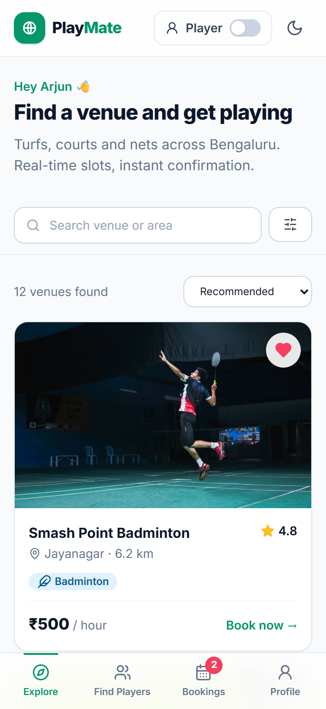 |
| 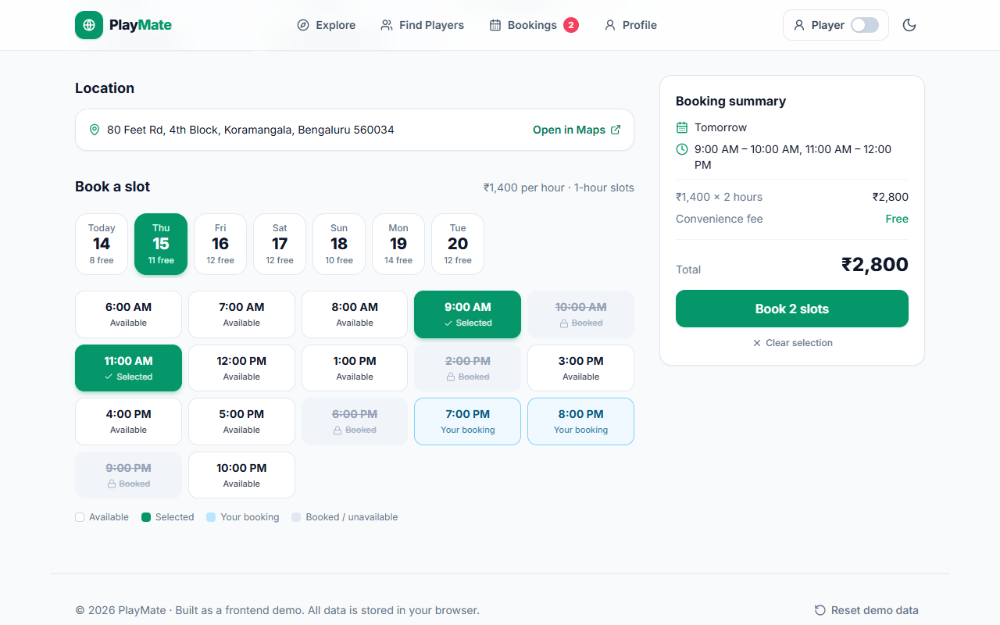 | 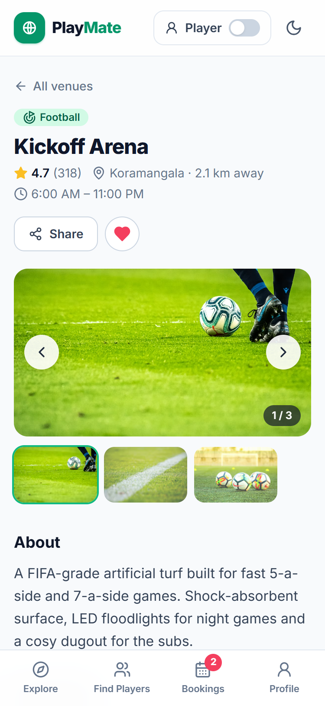 |
| 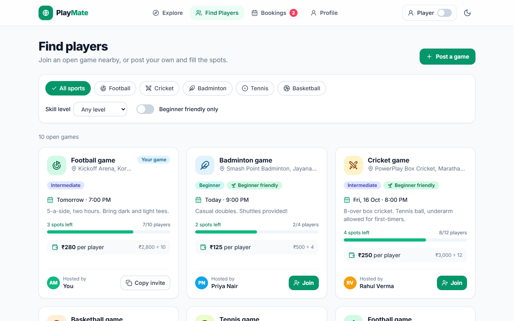 | 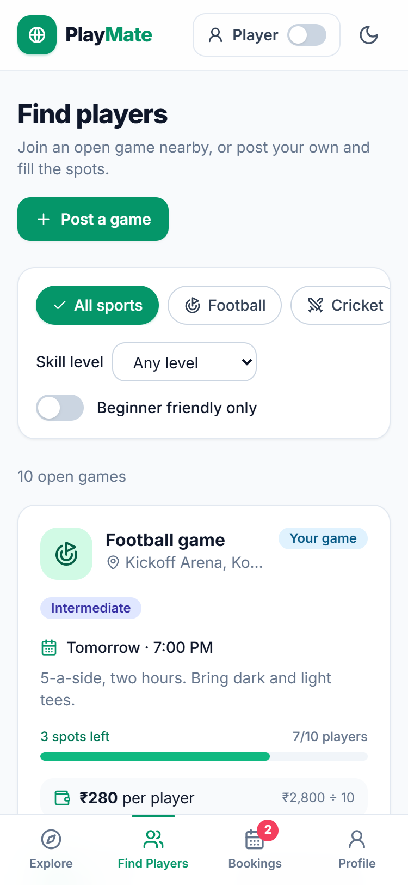 |
| 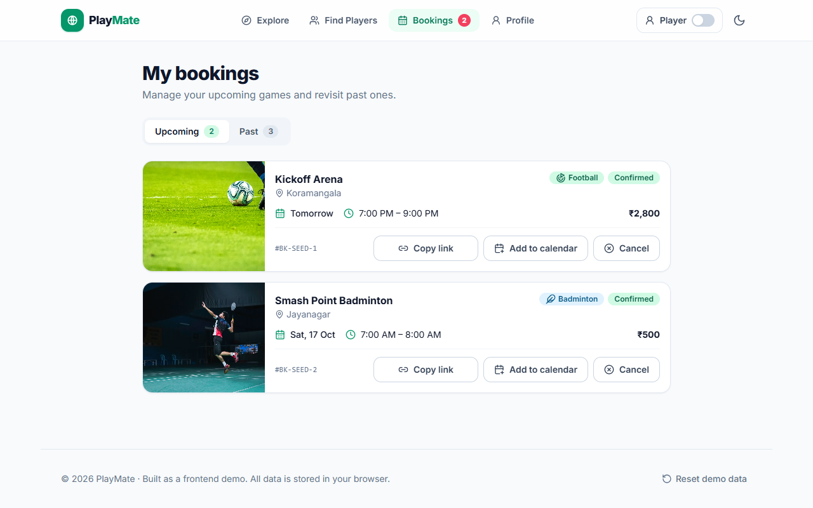 | 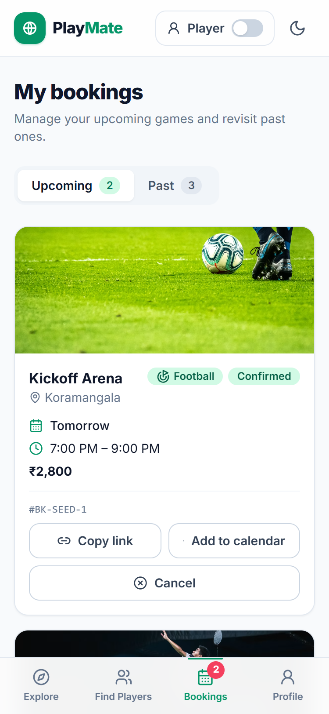 |
| 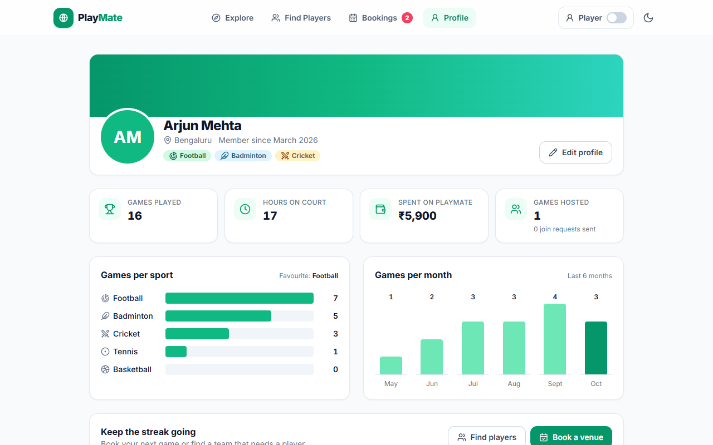 | 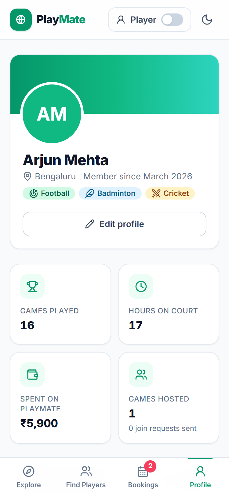 |
| 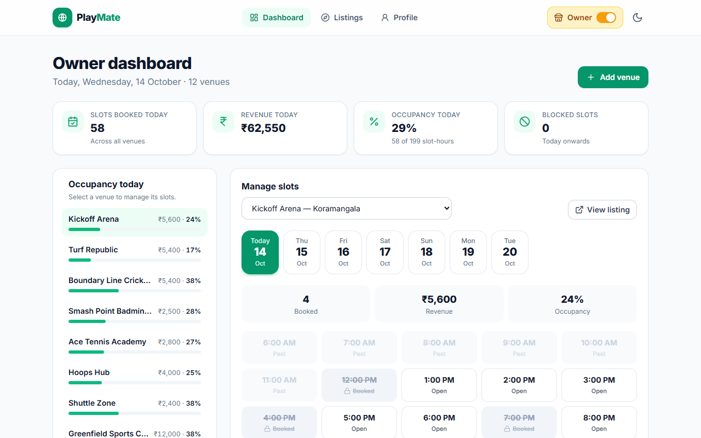 | 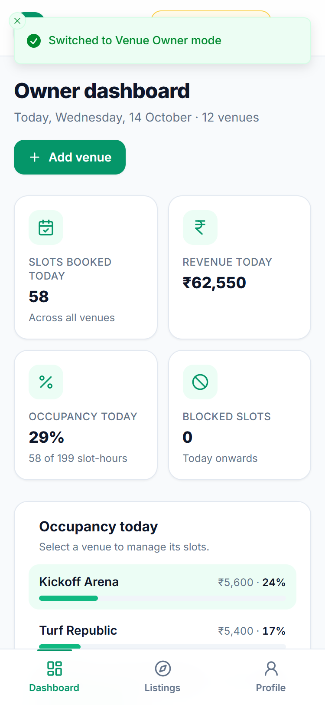 |
| 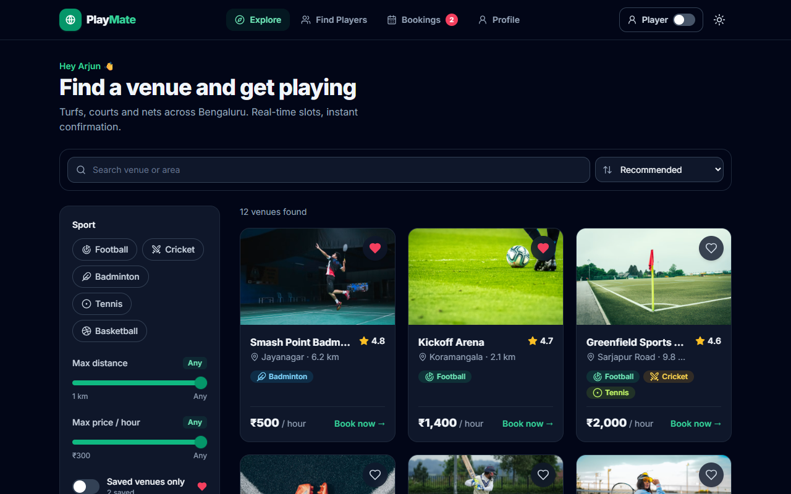 | |

---

**Tech:** React 18, TypeScript (strict), Vite 5, Tailwind CSS 3, React Router 6, Zustand, lucide-react, sonner. Photos are from [Unsplash](https://unsplash.com).
